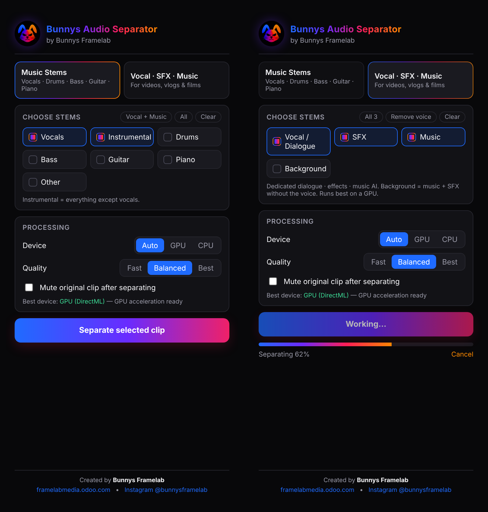

<p align="center"></p>

<h1 align="center">Bunnys Audio Separator</h1>
<p align="center">AI stem separation inside Adobe Premiere Pro — created by <b>Bunnys Framelab</b><br>
<a href="https://framelabmedia.odoo.com">framelabmedia.odoo.com</a> · <a href="https://www.instagram.com/bunnysframelab/">Instagram @bunnysframelab</a></p>

<p align="center"><a href="../../releases/latest"><b>⬇ Download the latest version</b></a></p>

<p align="center"></p>

---

## বাংলা

### এটা কী করে
Premiere Pro-র timeline-এ একটা clip select করে একটা button চাপলেই audio আলাদা আলাদা track-এ ভাগ হয়ে যায়। আলাদা হওয়া প্রতিটা stem মূল clip-এর সাথে একদম sync হয়ে বসে।

- **Music Stems:** গান থেকে Vocals, Drums, Bass, Guitar, Piano, Other আর Instrumental (vocal বাদে বাকি সব)
- **Vocal · SFX · Music:** ভিডিও বা ফিল্মের audio থেকে কথা, sound effect, music, আর Background (কথা বাদে বাকি সব)। এর জন্য আলাদা AI model ব্যবহার হয়।

### Download আর install
1. [Releases](../../releases/latest) page থেকে আপনার computer-এর **ZIP** নামান:
   - Windows: `…-Windows.zip`
   - Mac (M1/M2/M3/M4): `…-macOS-AppleSilicon.zip`
   - Mac (Intel): `…-macOS-Intel.zip`
2. ZIP খুলুন (Extract)। ভেতরে আছে installer, uninstaller আর **README.html**।
3. README.html খুলুন। Install, ব্যবহার আর uninstall-এর সব নিয়ম সেখানে বাংলা আর English দুই ভাষায় লেখা আছে।

### সংক্ষেপে
- **Install:** installer চালান, Premiere restart করুন, তারপর **Window → Extensions → Bunnys Audio Separator** খুলুন।
- **Uninstall:** ZIP-এর ভেতরের `Uninstall Bunnys Audio Separator` file চালান।

---

## English

### What it does
Select a clip in your Premiere Pro timeline, click one button, and get separated stems on new, perfectly synced audio tracks.

- **Music Stems:** Vocals, Drums, Bass, Guitar, Piano, Other, plus Instrumental (everything except vocals).
- **Vocal · SFX · Music:** dialogue, sound effects, music, and Background (everything except the voice) from video and film audio. Uses a dedicated AI model.

### Download and install
1. Download the **ZIP** for your computer from [Releases](../../releases/latest).
2. Unzip it. It contains the installer, an uninstaller and **README.html**.
3. Open README.html for full install, use and uninstall instructions (English and বাংলা).

### Features
- GPU acceleration: DirectML on Windows (NVIDIA, AMD and Intel GPUs) with fp16 models, and CoreML on Apple Silicon. Falls back to the CPU automatically.
- Processes only the part of the clip that is on the timeline.
- Supports speed-changed and reversed clips, and nested sequences.
- Quality presets: Fast, Balanced and Best. Device options: Auto, GPU and CPU.
- Models download once, on first use. The ZIP itself is small.

### How it works
```
Premiere Pro panel (CEP: HTML/JS + ExtendScript)
   │ spawns, reads JSON progress lines
   ▼
bunnys-engine (standalone binary, no Python needed)
   ├─ decode the clip range (FFmpeg via PyAV)
   ├─ STFT / iSTFT in NumPy
   └─ neural network in ONNX Runtime (CUDA / DirectML / CoreML / CPU)
        ├─ htdemucs_6s  Demucs v4, 6 music stems           (Meta AI, MIT)
        └─ bandit_dnr   BandIt Plus, speech/music/effects  (ZFTurbo MSST, MIT)
```
CI (`.github/workflows/`):
- `models.yml` exports both models to ONNX in fp32 and fp16, and checks them against the original PyTorch implementations.
- `release.yml` builds, smoke-tests, packages and publishes the Windows and macOS ZIPs.

### Build from source
```bash
pip install -r engine/requirements-windows.txt   # or requirements-macos.txt
python engine/build_engine.py                     # -> dist/extension/<bundle>/
```

### Code signing (optional)
Add these repository secrets and CI signs the builds automatically:
- **Windows:** `WINDOWS_PFX_BASE64`, `WINDOWS_PFX_PASSWORD`
- **macOS:** `APPLE_INSTALLER_P12_BASE64`, `APPLE_INSTALLER_P12_PASSWORD`, `APPLE_INSTALLER_IDENTITY`, `APPLE_ID`, `APPLE_TEAM_ID`, `APPLE_APP_PASSWORD`

Third-party licenses: see [THIRD_PARTY_NOTICES.md](THIRD_PARTY_NOTICES.md).
